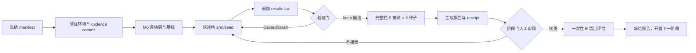

# 自动化推进方案

## 当前判断

仓库目前只有方案、ADR、术语表和三轮讨论，没有 Git 历史、评估层、数据入口、运行器、台账或阶段报告。因此第一轮自动化的目标是建立“可复现的 M0 控制平面”，不是直接搜索网络超参数。

Fable 和 Argon 的评论可以合并成几条执行边界：

- 主线使用当前已核实的 cadence `6499e56`，旧讨论中的 cadence 0.72.1 示例只能作为设计线索。
- M1 的静态 NeuralGraph 不调用 TemporalPatchNet 的 `contrast_asymmetry`；输入投射单向，微柱和出水口按 ADR-0002 保持对称。
- `qualified=True` 时 `nudged_steps` 与 `free_steps` 同量级；不能沿用讨论中的 `12`。
- `certificate` 是初始化和每个 epoch 的硬门禁。`scale_cap` 不约束行和，学习后必须重新检查。
- 证书失效就停止并记录该候选；不能在同一次任务里自动加大 decay 或重归一化。若要研究这些修正，先声明独立配置和假设。
- cadence 的 `decay` 不是 L1 在线剪枝；如需 L1/剪枝，必须作为适配层中的单独、可记录实验变量。
- T 会话只按 run 0–3 训练、run 4–5 选参；E 会话只由阶段门命令读取一次。任何普通运行器读 E 都应失败。
- 预注册拓扑检验使用输入敏感度；直接读某段权重的正负不能替代该判据。拓扑随机对照必须保留互惠配对，不能直接把 `cd.shuffled` 当成对称沙盘。
- 讨论中的跨被试预训练需要人决定；EA 与 ADR-0005 冲突，不作为自动搜索选项。

## M0 执行前审计结果

- Python 3.12.13、cadence 0.83.0、MOABB 1.7.2、Braindecode 1.8.1、scikit-learn 1.9.1 已在本机虚拟环境安装并导入验证。
- MOABB 1.7.2 的 `BNCI2014_001.get_data(sessions=...)` 在 `_get_selected_subject_data` 中过滤 session；其 `_get_single_subject_data` 先经 `_load_data_001_2014` 遍历并解析 T、E 两个文件。因此给 `sessions` 传 T 仍会先加载 E，不能用于研究循环。
- 在实现 T-only 数据适配层之前，不运行 MOABB `get_data`、`data_path` 或其缓存预热流程。适配层应只请求 `AxxT.mat`，同时保留 MOABB 认可的数据解析和事件编码；若只能调用 MOABB 私有解析函数，必须钉住 MOABB 版本并用小型合成文件测试。
- MOABB 元数据确认 22 EEG + 3 EOG，但当前未下载数据，也未确认是否存在独立 EOG 标定段。标定段问题保留为 M0 审计项；若无标定段，按 ADR-0005 只从 T 训练样本拟合 EOG 回归系数。
- 当前 manifest 是 `bootstrap_only`：它校验协议边界，不代表数据加载器、评估器、实验调度器或留出门已经就绪。

本机 A01 的 T-only 冒烟已完成：请求的文件为 `A01T.mat`，SHA-256 为 `054f02e70cf9c4ada1517e9b9864f45407939c1062c6793516585c6f511d0325`；解析出 6 个有事件 run、每个 48 个试次、250 Hz、22 EEG + 3 EOG，数据目录中没有 `A01E.mat`。源 MAT 还含 3 个无事件记录，MOABB 转换器会丢弃它们；它们是否是 EOG 标定材料仍未由数据说明确认，不能自动当作标定段。

## 自动化控制平面

自动化分成五层，每层产生下一层所需的可验证证据。

1. **协议层**：`automation/stage_manifest.json` 固定 cadence commit、依赖版本、数据集、训练/验证/留出边界、被试数、种子和阶段候选。`automation/validate_manifest.py` 与 `automation/check_environment.py` 在运行前失败即停。
2. **评估层**：M0 先盘点 MOABB 数据实际包含的 EOG 标定材料，再冻结 EOG 处理、4–35 Hz 清洗、子窗切分、Track-1/Track-2 编码、T 切分和评分。T 运行器必须显式只请求 T 会话，不能先加载 T/E 再过滤；之后实验代码只能调用冻结评估层，不能自行切分数据。
3. **实验层**：每个 `stage × arm × subject × seed` 是独立任务。任务读取只允许当前阶段声明的数据，输出事件日志、模型快照、收敛/拒行统计和 JSON receipt。
4. **调度层**：快速档先跑 A01 和小预算筛选；候选进入完整档后跑 9 名被试 × 3 种子。单次任务超出该档预算上限的 2 倍自动标为 `crash`，保留日志并继续队列。
5. **决策层**：任务完成后先追加 `results.tsv`，再按验证 κ、种子波动、合格率和成本执行 keep/discard。候选提交保留可达的 Git ref，避免 discard 的 commit 被 reset 后变成不可追溯的台账哈希。只有阶段门命令可以读取 E 并生成带唯一候选 ID 的 holdout receipt；receipt 落盘后拒绝重复读取该候选。看过 E 后自动把项目状态切换到“需新阶段”。

推荐的任务图如下：



## 运行器必须记录的证据

每次任务都要绑定：Git commit、cadence commit 和源文件哈希；数据集版本/下载缓存哈希；stage、arm、subject、seed；完整配置；训练与验证样本计数；自由相/微扰相合格率、拒行数、拒学数、证书状态、耗时和峰值内存；预测、标签和 κ/准确率；失败原因和完整 stdout/stderr 路径。

receipt 应能由独立 verifier 重新计算指标。验证器遇到缺行、缺 seed、非有限值、证书失效、训练读取 E 或 holdout 重复评估时必须失败，而不是用剩余行计算平均值。

## 阶段门与无人值守边界

阶段内可以无人值守：提出单变量假设、创建候选 commit、运行快速/完整档、记录失败、按验证集规则保留或丢弃、生成阶段报告草稿。

阶段门必须停下等待人的审阅：接受或推翻 ADR、修改冻结评估层、首次读取 E、引入新数据集、决定跨被试预训练、接受 M5 连续目标来源。自动化可以准备证据，但不能替人作这些边界决定。

## M0 的最小执行顺序

1. 建立 Python 3.12 环境，安装当前 cadence editable、MOABB、Braindecode、scikit-learn 和 `[fast]` 依赖；记录实测命令、版本和 A01 单被试耗时。快速档/完整档预算等试跑后实测再冻结。
2. 先做数据审计：确认 MOABB 是否提供 EOG 标定段，并验证接口可以只加载 T；据 ADR-0005 确认 EOG 系数只能来自标定材料或 T 训练数据。实现并冻结 `eval/`：滤波、11 个子窗、双轨特征、T 切分和评分；先做无数据的形状/边界检查，再下载 A01。
3. 用同一评估层运行同输入 LDA、FBCSP、EEGNet 和打乱标签对照。每个配置至少记录 3 个种子；验证 κ 只用于选择，E 只在 M0 阶段门各评一次。
4. 建立 `results.tsv`、`runs/`、`receipts/` 和 `reports/M0.md` 的生成器。先记录成功、失败和崩溃，再做候选取舍。
5. M0 阶段门确认 EOG 标定段、机会水平对照、实测预算和冻结评估层后，才开始 M1 的 cadence 沙盘。

## 第一版命令接口

当前仓库只提供 manifest 校验；M0 运行器完成后，命令应固定为以下形状：

```powershell
.venv\Scripts\python.exe automation/validate_manifest.py
.venv\Scripts\python.exe automation/check_environment.py
python -m ep_eeg.run --stage M0 --arm lda_track2 --subject A01 --seed 0
python -m ep_eeg.run --stage M0 --arm fbcsp --all-subjects --seed 0
python -m ep_eeg.gate --stage M0 --validation-only
python -m ep_eeg.gate --stage M0 --read-holdout
```

`--read-holdout` 必须是显式的阶段门动作，普通 `run` 命令不提供该选项。
