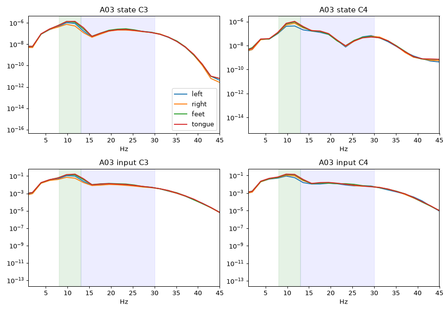
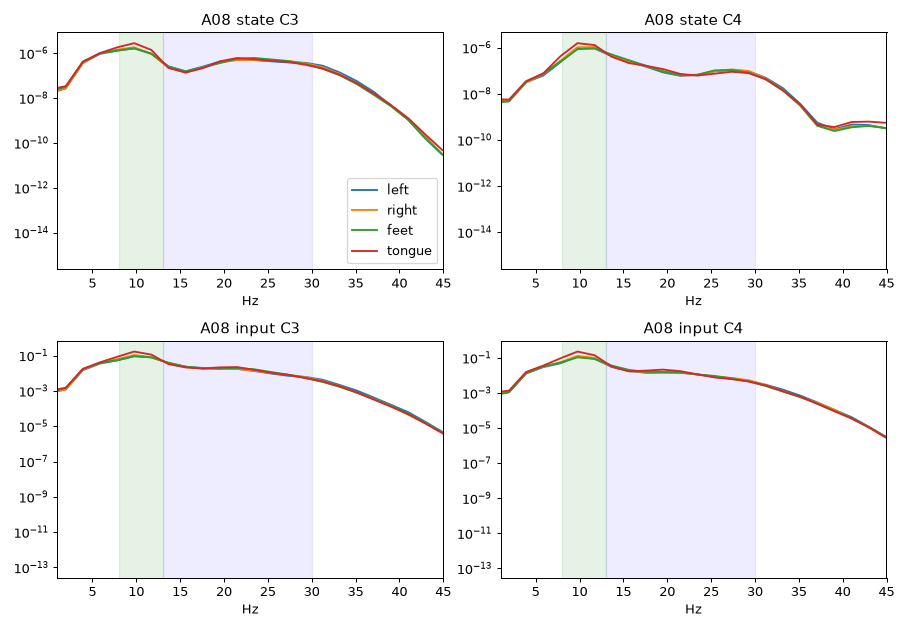

# M7：整段原始波形 + 内部时间步 warm

> 只用已有回执撰写；未开新训练。臂 `ep_rawseq_warm`，代码 commit `0633300`。状态：**discard（机会水平）**。

## 数据
BCI Competition IV-2a（MOABB `BNCI2014_001`），9 被试 A01–A09，被试内；T run0–3 训练（192 试次/人），run4–5 验证（96 试次/人），四类 MI。E 未读。

## 输入构造
- 预处理同前：去均值 → EOG 回归 → 4–35 Hz 零相移带通 → 逐导联 Z-score（train 拟合）→ tanh(x/3)。
- 截取提示后 0.5–3.5 s 整段（22×750），**不切 11 子窗、不做 Hjorth**。
- 整段按时间切成 **30 个时间步**，每步 22 导 × 25 个原始采样点 → **d=550**，无下采样。
- 逐步结算，上一步自由相终态作为下一步 `warm` 起点，x 在 3 s 内连续演化；按最后时刻输出判决。
- opts：epochs=100，sigma_in=0.012，leak=1.0，rowmass_project=0.9，eta=0.5，temperature=0.01（其余同 M1 最佳）。

## 训练时长 / 硬件
Linux 8 核 CPU，无 GPU，jobs=4。快速档（9 被试 × seed 0）总墙钟 **8808 s（≈2.4 h）**。

## κ（vs 同输入 LDA 0.3889）
| 臂 | 档 | κ_val | acc | 合格率 | 墙钟 |
|---|---|---:|---:|---:|---:|
| ep_rawseq_warm | fast 9×1 | **−0.0077** | 0.244 | 1.0 | 8808 s |
| LDA（Track-2，M0） | — | 0.3889 | — | — | 秒级 |

逐被试 κ：A01 0.000，A02 0.028，A03 −0.125，A04 0.000，A05 0.069，A06 0.000，A07 0.056，A08 −0.069，A09 −0.028。整体是机会水平，远低于 LDA。
回执：`receipts/M7/ep_rawseq_warm/0633300_20aa2a_fast/summary.json`。

**未运行/无回执的：**
- 完整档 9×3：已启动，因快速档为机会水平被**主动停止**（不是崩溃），无回执。
- 早期子窗原始波形臂（commit `c61c434`）：没有留下回执，不计入结果。
- 冷启动对照 `ep_rawseq_cold`：**未运行**。

## 内部状态功率谱
探针：A03、A08 seed 0 单独训练（训练墙钟约 4545 s / 4437 s），在验证试次上记录 C3/C4 对应微柱的 x 时间序列（fs=250，726 点），做 Welch PSD。
类别顺序：左手 / 右手 / 双脚 / 舌头。

| 被试 | 导联 | 峰值比 mu / beta | mu 按类 (L,R,F,T) | beta 按类 | ERD 检查 |
|---|---|---|---|---|---|
| A03 | C3 | 5.19 / 0.83 | 9.7e-7, 6.2e-7, 1.2e-6, 1.4e-6 | 1.6e-7, 1.4e-7, 1.9e-7, 1.8e-7 | C3 右<左：mu ✓ beta ✓ |
| A03 | C4 | 15.16 / 2.21 | 4.2e-7, 6.2e-7, 7.8e-7, 8.7e-7 | 8.3e-8, 9.9e-8, 1.0e-7, 1.1e-7 | C4 左<右：mu ✓ beta ✓ |
| A08 | C3 | 2.32 / 0.57 | 1.3e-6, 1.4e-6, 1.3e-6, 2.1e-6 | 3.6e-7, 3.6e-7, 3.8e-7, 3.7e-7 | C3 右<左：mu ✗ beta ✓ |
| A08 | C4 | 11.06 / 1.56 | 9.3e-7, 1.0e-6, 8.9e-7, 1.4e-6 | 1.5e-7, 1.5e-7, 1.6e-7, 1.4e-7 | C4 左<右：mu ✓ beta ✓ |

**解读注意**：x 的标准差很小（C3：A03 ≈0.0030，A08 ≈0.0043），状态几乎贴在静息点附近；mu 峰很可能只是输入带通波形的直接传递。模型分类在机会水平，所以这里的 ERD 方向**不能当作解码证据**，最多说明网络能把输入里的节律原样传进内部状态。

## 结论
整段原始波形 + 内部 warm 这一设定在当前规模（192 试次/人、100 epoch、8 核 CPU）下**学不到可用的判别信息**（κ≈0），比 Track-2 EP（M6 0.335）和 LDA（0.389）都差得多。内部状态带有 mu 节律，但幅度极小、和标签没有可靠联系。按协议标为 discard。

## 待决问题
1. `ep_rawseq_cold` 冷启动对照没跑，所以还分不清失败来自 warm 链，还是来自原始输入本身。
2. 输入增益/sigma_in 或 drive 尺度是否过小（x std ~0.003）；是否需要放大 drive 或改读出方式（时间平均而非末时刻）。
3. 完整档 9×3 是否值得重跑（建议先解决 1、2）。
4. 按 AGENTS「实验原则」往 scale 方向走（M8：整段 T、多被试串联），需要人工确认切分。
